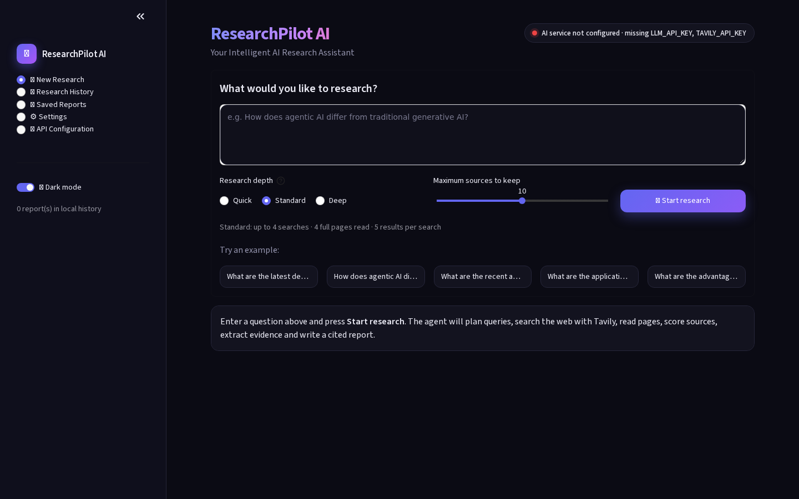
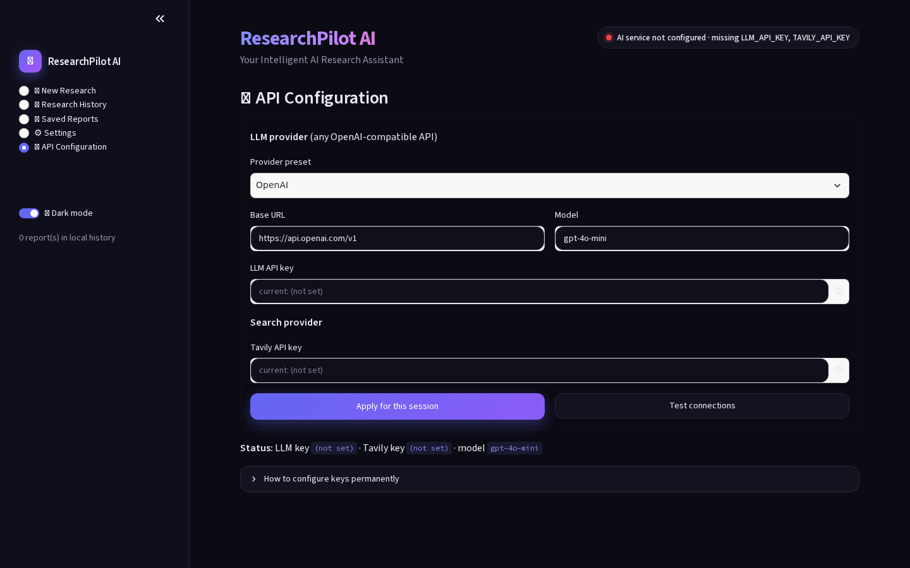
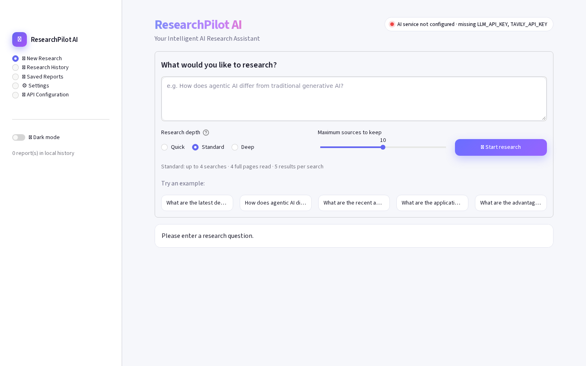

# 🧭 ResearchPilot AI — Tool-Using Research Agent

> **Your Intelligent AI Research Assistant.** Ask a question in plain English. An LLM-driven agent plans the research, **calls real tools**
> (Tavily web search, page reader, source scorer, evidence extractor), evaluates the sources, and writes a structured report with
> **numbered, clickable citations that point to the pages it actually retrieved**.

| | |
|---|---|
| Language | Python 3.11+ |
| UI | Streamlit + custom CSS (dark / light) |
| LLM | any OpenAI-compatible API (configurable) |
| Search | Tavily Search API |
| Agent | transparent custom tool-calling loop (no hidden framework) |
| Storage | SQLite · export to Markdown & PDF |

**Status of this repository (honest summary)**
- ✅ Full application implemented; **48 automated tests pass** (offline, using mocked HTTP and a scripted fake LLM — see [Testing](#testing)).
- ⚠️ The build environment had **no Tavily / LLM API keys**, so the live 5-question validation has **not been run by the author yet**. A one-command script is included (`python scripts/run_validation.py`) and the results table below is intentionally left for you to fill from a real run.
- ⚠️ No hosted live demo is claimed. Deployment steps for Streamlit Community Cloud are below.

---

## 1. Problem statement
Chatbots answer from memory and often invent facts or URLs. Researchers need answers that are **grounded in retrievable sources**, with
an honest view of source quality, disagreement and gaps.

## 2. Objectives
Build an agent that decides *by itself* when to search, retrieves from multiple sites, scores source quality, extracts verifiable evidence,
synthesises across sources, and cites only real, retrieved pages.

## 3. Features
- **Autonomous planning** – topic, keywords, intent, "needs current info?", sub-questions, 2–4 search queries, research plan.
- **True tool calling** – the LLM chooses among `web_search`, `read_webpage`, `analyze_sources`, `extract_evidence`, `finish_research`; Python executes them and returns results to the LLM.
- **Iterative research** – the agent sees a STATUS line (searches used, sources, evidence) and may search again to fill gaps; stops on sufficiency or a configurable budget (Quick / Standard / Deep).
- **Source evaluation** – transparent scores for relevance, authority (gov/edu/journals preferred), freshness, evidence support; duplicate detection (URL, content fingerprint, near-identical titles).
- **Evidence extraction** with *verbatim quote verification* against the page text; per-publisher cap and repeated-statement removal; cross-source corroboration.
- **Citations done by code** – invalid `[n]` markers are stripped, the reference list (title, publisher, URL, publication date, access date) is generated from real records, inline `[n]` are clickable.
- **Transparency panel** – queries, results retrieved, sources selected, every tool call (and whether the *LLM* or the *autopilot safety net* chose it), stages, warnings. No chain-of-thought is exposed.
- **Dashboard** – header + connection status, sidebar (New Research, History, Saved Reports, Settings, API Configuration), depth + source-limit selectors, example questions, live 7-stage progress, report tabs, source cards with *Open source* button.
- **History & export** – SQLite history, save/bookmark, delete, export PDF / Markdown.
- **Robust errors** – missing/invalid keys, search & LLM failures, timeouts, empty results, invalid input, unreachable pages, SSRF-safe page fetching.

## 4. Technology stack
Python 3.11+, Streamlit, `openai` SDK (OpenAI-compatible endpoints), Tavily REST API via `requests`, BeautifulSoup, pandas, SQLite, fpdf2, python-dotenv, pytest.

## 5. Architecture & agent workflow
See [docs/ARCHITECTURE.md](docs/ARCHITECTURE.md). In short:

1. **Query analysis + plan** (`agent/research_planner.py`)
2. **Tool loop** (`agent/research_agent.py` + `agent/tool_selector.py`): LLM → tool call → Python function → result → LLM … until `finish_research` or budget
3. **Safety net** (`_autopilot`): if the model never calls tools (e.g. provider without function calling) the minimum pipeline still runs and is labelled `autopilot` in the trace
4. **Select & number sources** (only sources with evidence) → **synthesis** from numbered evidence (`agent/research_synthesizer.py`)
5. **Citation validation, references, claim-support check** (`utils/citations.py`) → final report

```
researchpilot-ai/
├── app.py                      # Streamlit dashboard (UI only)
├── agent/        research_agent.py · research_planner.py · tool_selector.py · research_synthesizer.py · llm.py · state.py
├── tools/        web_search.py (A) · webpage_reader.py (B) · source_evaluator.py (C) · evidence_extractor.py (D)
├── database/     database.py (SQLite)
├── utils/        config.py · citations.py · export.py
├── assets/       custom.css
├── tests/        test_search.py · test_citations.py · test_agent.py · conftest.py
├── scripts/      run_validation.py   # real-API validation of the 5 test questions
├── sample_reports/example_report.md
└── docs/         ARCHITECTURE.md · screenshots/
```

## 6. Installation
```bash
git clone https://github.com/appureddy1102-cloud/researchpilot-ai.git
cd researchpilot-ai
python -m venv .venv && source .venv/bin/activate      # Windows: .venv\Scripts\activate
pip install -r requirements.txt
```

## 7. API configuration
You need **two keys**:

| Key | Where to get it |
|---|---|
| `TAVILY_API_KEY` | https://app.tavily.com (free tier) |
| `LLM_API_KEY` | OpenAI, or any OpenAI-compatible provider (OpenRouter, Groq, Gemini, local Ollama …) |

```bash
cp .env.example .env      # then edit .env with your values (never commit .env)
```
Switch provider by changing only `LLM_BASE_URL` and `LLM_MODEL` (examples are in `.env.example`). Models must support OpenAI-style tool/function calling for the best behaviour; otherwise the autopilot safety net completes the run.
You can also paste keys into the app's **🔑 API Configuration** page (kept in memory for that browser session only, never stored).

Keys are never hard-coded, logged, written to the database or included in reports (`utils.config.redact` scrubs error messages).

## 8. Run
```bash
streamlit run app.py
```
Open http://localhost:8501 → enter a question → **Start research**.

## 9. Deploy to Streamlit Community Cloud
1. Push this repo to GitHub (done if you are reading this there).
2. Go to https://share.streamlit.io → **Create app** → pick this repository, branch `main`, main file `app.py` (Python 3.11 or newer in *Advanced settings*).
3. In **Advanced settings → Secrets** paste:
   ```toml
   LLM_API_KEY = "..."
   LLM_BASE_URL = "https://api.openai.com/v1"
   LLM_MODEL = "gpt-4o-mini"
   TAVILY_API_KEY = "tvly-..."
   ```
4. Deploy. Note: Community Cloud storage is ephemeral, so SQLite history resets when the app restarts.

*Live demo URL: not deployed by the author yet — add yours here after you have tested it.*

## 10. Screenshots
| New research (dark) | API configuration (dark) |
|---|---|
|  |  |

| New research (light) | Input validation |
|---|---|
|  |  |

> Screenshots of a finished report are not included because generating one requires your API keys. Run the app and add them.
> The screenshots were taken in a Linux sandbox without an emoji font, so some icons render as boxes there; they display normally in a real browser.

## 11. Example questions & outputs
Built-in examples: *latest developments in AI · agentic vs generative AI · recent advances in drug delivery systems · ML in healthcare · advantages and limitations of renewable energy.*
A format example of an exported report is in [`sample_reports/example_report.md`](sample_reports/example_report.md) — read its header: it was compiled by hand from real sources, **not** generated by the app.

## Testing
```bash
pip install -r requirements-dev.txt
python -m pytest -q
```
**Result when last run by the author: 48 passed.** These tests are offline: HTTP is mocked and the LLM is a scripted fake (in `tests/conftest.py` only — the app never ships fake data). They verify:
the Tavily client's request/parsing and every error path (401, 429, 432, 400, timeout, network, empty); page-cleaning and SSRF blocking; URL normalisation and duplicate detection; authority/freshness scoring;
quote verification (invented quotes rejected); evidence de-duplication; the full agent loop (LLM-selected tools executed, duplicates removed, invalid citations stripped, references complete);
the autopilot fallback; LLM-down fallbacks; search failure and empty results; invalid input; SQLite CRUD; PDF/Markdown export (incl. Unicode and very long URLs).

### Live validation with real APIs (run this yourself)
```bash
python scripts/run_validation.py            # or: --depth Standard
```
It runs the 5 suggested questions with your keys, checks that every cited URL responds, reports the heuristic claim-support ratio, and writes `validation_results/summary.md` and one report per question.

| # | Question | Status | Queries | Retrieved | Cited | URLs OK | Claim check |
|---|---|---|---|---|---|---|---|
| 1–5 | *(fill from `validation_results/summary.md` after your run)* | | | | | | |

A manual checklist for each question: ① queries shown in *Research process* ② source URLs open the right page ③ each cited sentence is supported by that page ④ unplug the network / use a wrong key to see the error handling ⑤ the report is readable.

## 12. Limitations
- Quality depends on the LLM and on Tavily's index; paywalled or JavaScript-rendered pages can't be read (snippets are used instead, and this is shown).
- Source authority is a **domain-based heuristic** (editable table), not a judgement of each article. Vendor blogs and unknown domains score low on purpose.
- The claim-support check is lexical overlap, not logical entailment — treat flagged sentences as "verify me", unflagged ones as "not obviously wrong", never as proof.
- Publication dates come from Tavily/page metadata and are often missing (shown as "Not available").
- PDF export uses Latin-1 fonts: non-Latin characters are transliterated to `?` (the Markdown export keeps Unicode).
- SQLite history on Streamlit Community Cloud is not persistent.

## 13. Future improvements
Async/parallel page reading · LangGraph version of the loop · NLI-based claim verification · PDF/academic-paper readers (Semantic Scholar, PubMed APIs) · persistent cloud DB and user accounts · Unicode PDF fonts · streaming report output.

## Security notes
`.env` and `.streamlit/secrets.toml` are git-ignored; only `.env.example` (placeholders) is committed. If a key was ever pasted somewhere public, **revoke and regenerate it**.

## License
MIT
